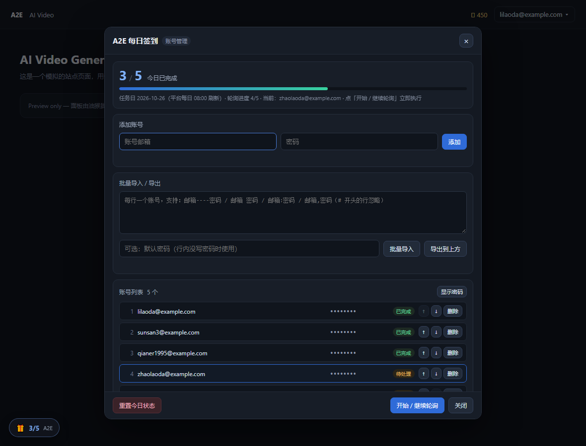

# A2E 每日签到（多账号轮询）

> 面向 [A2E AI 视频/图像创作平台](https://video.a2e.ai/) 的 Tampermonkey 用户脚本：多账号依次登录 → 领取每日免费积分 → 退出 → 切换下一个账号，并实时显示今日完成进度。

> ⚠️ 本项目与 A2E 官方无关，仅供个人学习与自用。请遵守平台服务条款，风险自负。

## 功能

- **全自动轮询**：每次页面加载只处理一个账号，逐页推进，直到当天全部完成。
- **账号管理面板**：页面左下角悬浮按钮打开，支持添加、改密、批量导入/导出、删除、上移/下移调整处理顺序、显示/隐藏密码。
- **今日进度**：面板顶部 `x / y` + 进度条，悬浮角标常驻显示；菜单与结束通知同步播报。
- **跳过已完成**：已处理完的账号不会白跑一次登录/退出。
- **分类型重试**：限制 / 超时 / 读不到积分各有独立重试计数；遇到限制类提示不退出、不推进索引。
- **跨 08:00 任务日**：平台每日 **08:00** 刷新，运行中不会中途切日。
- **单例锁**：同一浏览器只允许一个标签运行，避免互抢登录/退出。
- **人工验证兜底**：出现 Cloudflare Turnstile 交互挑战时通知并等待 3 分钟。

## 截图



## 安装

### 方式一：一键安装（推荐）

1. 安装 [Tampermonkey](https://www.tampermonkey.net/)（或 Violentmonkey 等兼容 `GM_*` API 的脚本管理器）。
2. 点击安装：**[a2e-daily-checkin.user.js](https://raw.githubusercontent.com/Mingtuo916/a2e-daily-checkin/main/a2e-daily-checkin.user.js)**。
3. Tampermonkey 弹出安装页后确认安装。

### 方式二：手动安装

从 [Releases](https://github.com/Mingtuo916/a2e-daily-checkin/releases/latest) 下载 `a2e-daily-checkin.user.js`，拖进 Tampermonkey 的「已安装脚本」页面。

## 使用

1. 打开 <https://video.a2e.ai/>，页面左下角会出现 🎁 悬浮按钮（角标显示今日 `x/y`）。
2. 点开面板，录入账号：
   - 单个添加：填写邮箱 + 密码 → 「添加」（同邮箱再添加 = 改密）。
   - 批量导入：每行一个账号，支持下面几种写法，粘进文本框 → 「批量导入」。
3. 点「开始 / 继续轮询」；之后每次正常打开站点会自动续跑。

### 批量导入格式

| 写法 | 示例 |
|---|---|
| `邮箱----密码` | `user@example.com----your-password` |
| 空格分隔 | `user@example.com your-password` |
| 冒号分隔 | `user@example.com:your-password` |
| 逗号分隔 | `user@example.com,your-password` |
| 只写邮箱 | `user@example.com`（使用「默认密码」输入框） |

- 行首 `#` 或 `//` 是注释，会被忽略。
- 同一批里重复的邮箱，**后写的密码覆盖先写的**。
- 列表顺序 = 处理顺序：越靠前越先跑。受平台"单 IP 约 4 个账号"限制时，把要跑的账号排前面。

### 进度与重置

- `x / y`：`x` = 当前列表里今日已完成的账号数，`y` = 账号总数；任务日按平台 **08:00** 刷新。
- 「重置今日状态」：清空完成标记、索引与重试计数，**不会删除账号列表**。
- 「开始 / 继续轮询」：从第一个未完成账号继续（之前跳过或失败的账号会重试）。

## 工作原理

```
每次页面加载处理一个账号：
读索引 → 目标账号已完成则跳过 → 未登录则登录 → 读签到前积分
→ 点「立即领取」→ 轮询积分是否真正上涨 → 成功 / 已签到 / 限制 / 超时分支
→ 退出登录 → 索引 +1 → 刷新，进入下一个账号
```

核心原则：**积分没有实际增加时不退出、不推进索引**，除非判定为"今日已签到"或重试次数用尽。

更详细的平台行为、选择器说明、踩坑记录与版本演进见 [开发日志](docs/开发日志.md)。

## 账号与隐私

- **脚本与仓库内不含任何账号或密码**，账号由你自行在面板录入。
- 账号保存在脚本管理器（Tampermonkey）的 **GM 存储** 中，升级脚本不会丢失。
- 账号**不会写入页面 `localStorage`**，避免站点脚本读取到密码。
- 请勿提交或分享「批量导入」文本、Tampermonkey 配置备份——里面是明文密码。
- 换电脑/重装脚本管理器前，先在面板点「导出到上方」备份账号文本。

## 注意事项

- **平台风控**：短时间内批量登录、批量领奖可能触发"操作频繁 / 上限"，严重时会冻结积分或封号。建议每天只跑一次，并控制账号数量。
- 脚本依赖页面 DOM，站点改版后选择器可能失效；失效时日志会停在等待页面元素的阶段。
- 需要保持站点页面打开（脚本按页面加载逐轮推进），并允许 Cloudflare Turnstile 正常加载。
- 本项目仅用于学习浏览器自动化与用户脚本开发，请自行确认使用方式符合平台条款。

## 目录结构

```
.
├── a2e-daily-checkin.user.js   # 用户脚本（安装这个）
├── README.md
├── LICENSE
├── assets/
│   └── panel.png               # 面板截图
└── docs/
    └── 开发日志.md              # 平台行为事实、架构、踩坑与版本演进
```

## 更新日志

- **1.0.14**：移除硬编码账号/密码，新增账号管理面板与「今日已完成 x/y」显示；跳过已完成账号；账号变动后自动修正索引。
- **1.0.13**：跨 08:00 不切日、单例锁、`readPoints()` 健壮性、读不到积分改为刷新重试。

完整记录见 [开发日志](docs/开发日志.md)。

## License

[MIT](LICENSE) © 2026 Mingtuo916
